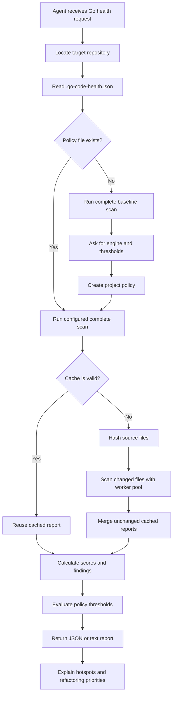

<!-- markdownlint-disable MD013 MD041 -->
[](https://app.codacy.com/gh/sghaida/skills/dashboard?utm_source=gh&utm_medium=referral&utm_content=&utm_campaign=Badge_grade)
[](https://app.codacy.com/gh/sghaida/skills/dashboard?utm_source=gh&utm_medium=referral&utm_content=&utm_campaign=Badge_coverage)
<!-- markdownlint-enable MD013 MD041 -->

# Skills

This repository contains reusable agent skills that extend coding agents with
focused workflows, project guidance, and practical developer tooling. Each
skill is self-contained so it can be installed and used independently in an
agent-enabled development environment.

## `chnq` — Code Health and Quality

`chnq` is a portable Agent Skill with a dependency-free Go static analyzer. It
returns a deterministic, explainable 0–10 structural maintainability score at
repository, package, and file levels.

## Current Capabilities vs. Market Leaders

<!-- markdownlint-disable MD013 MD060 -->

| Feature                              | chnq      | SonarQube          | CodeScene        | GolangCI-Lint      | Codacy       |
|--------------------------------------|-----------|--------------------|------------------|--------------------|--------------|
| **Structural Maintainability Score** | ✅ (0-10) | ✅ (A-F)            | ✅                | ❌                  | ✅            |
| **Go-Specialized**                   | ✅         | ❌ (generic)        | ❌ (generic)     | ✅                  | ❌ (generic) |
| **Architecture Health Metrics**      | ✅ (3)    | ✅ (rules)          | ✅ (architecture) | ✅ (linters)       | ✅ (rules)   |
| **Deterministic**                    | ✅         | ❌ (rules-based)    | ❌ (rules-based) | ✅                  | ❌            |
| **Zero Dependencies**                | ✅         | ❌ (needs Java, DB) | ❌ (SaaS)        | ❌ (needs plugins)  | ❌ (SaaS)    |
| **Security Scanning**                | ❌         | ✅                  | ❌               | ✅                  | ✅            |
| **Test Coverage**                    | ❌         | ✅                  | ✅               | ❌                  | ✅            |
| **Git History Analysis**             | ✅ (opt-in) | ❌                | ✅               | ❌                  | ❌            |
| **CI/CD Integration**                | ✅         | ✅                  | ✅               | ✅                  | ✅            |
| **Caching + Incremental Scans**      | ✅         | ✅                  | ✅               | ❌                  | ✅            |
| **Hotspot Explanations**             | ✅         | ✅                  | ✅               | ❌                  | ✅            |
| **Performance Metrics**              | ✅         | ❌                  | ✅               | ❌                  | ❌            |
| **API/Dashboard**                    | ❌         | ✅                  | ✅               | ❌                  | ✅            |

<!-- markdownlint-enable MD013 MD060 -->

## How the Skill Works

The skill guides an agent through a deterministic, read-only health analysis:



### Analysis Flow

1. The agent identifies the Go repository and reads its optional project policy.
2. The analyzer uses the configured duplication engine and scans source files
   without building or executing the target repository.
3. A local cache reuses unchanged results; changed files are processed by a
   bounded worker pool and merged deterministically.
4. The analyzer calculates the four weighted health dimensions plus
   independent cycle, interface-compliance, and duck-typing scores, then
   produces repository, package, and file reports.
5. The policy gate checks the overall score, dimension thresholds, and health
   thresholds before reporting pass or fail.
6. The agent reports measured findings, hotspots, and deterministic improvement
   suggestions.

### Quick start

The analyzer requires Go 1.27.3. It has no third-party Go dependencies.

From the repository root, analyze a Go repository as text:

```sh
./chnq/scripts/analyze.sh /path/to/your/go/repo --format text
```

Produce a JSON report:

```sh
./chnq/scripts/analyze.sh /path/to/your/go/repo --format json > health.json
```

Use it as a CI quality gate. This command exits with code 3 when the score is
below the requested threshold:

```sh
./chnq/scripts/analyze.sh /path/to/your/go/repo --fail-under 7
```

Scans use a local `.chnq-health-status` cache (ignored by Git). Unchanged
repositories reuse the cached report; when the cache detects a partial change,
only changed files are rescanned and merged with unchanged results. File
parsing uses 10 workers by default and can be tuned with `--workers 1-256`.
Use `--no-cache` for a complete rescan:

```sh
./chnq/scripts/analyze.sh /path/to/your/go/repo --workers 20
./chnq/scripts/analyze.sh /path/to/your/go/repo --no-cache
```

Generate deterministic hotspot explanations without an LLM. The default scope
is files; `package` aggregates low-scoring files by enclosing package:

```sh
./chnq/scripts/analyze.sh /path/to/your/go/repo \
  --explain-hotspots --hotspots-scope package
```

### Project policy and required health gate

For ongoing agentic development, keep a checked-in `.go-code-health.json` at
the root of each project being analyzed. The policy records the acceptable
overall score and, optionally, minimum scores for individual dimensions:

```json
{
  "version": 1,
  "duplication_engine": "internal",
  "minimum_score": 7.0,
  "minimum_dimensions": {
    "complexity": 6.0,
    "structure": 7.0,
    "duplication": 8.0,
    "cyclic_dependencies": 8.0,
    "interface_compliance": 7.0,
    "duck_typing": 7.0
  },
  "broad_interface_threshold": 5,
  "include_tests": false
}
```

On the first run, choose the duplication engine:

- `internal` (recommended default): dependency-free Go token detection
- `jscpd-rs`: invokes the installed `jscpd` executable for broader clone
  detection

Install the optional engine with:

```sh
make install-jscpd-rs
```

`make deps` also installs `jscpd-rs` automatically when the repository's
`.go-code-health.json` selects `"duplication_engine": "jscpd-rs"`.

The selected engine is recorded in `.go-code-health.json` and is included in
the analyzer's JSON report. If `jscpd-rs` is selected but `jscpd` is not
installed, the analyzer reports an explicit setup error rather than silently
using a different engine.

On the first run, if the file is absent, the skill performs a full scan,
shows the baseline, asks the user to choose the thresholds, and creates the
file in the project repository. It must run a full scan before every coding
task and again after changes. A task passes only when the scan is complete and
the overall score and every configured dimension meet their thresholds. If an
existing policy fails, code-health remediation takes priority and the agent
must update the code toward the configured values before unrelated work.

See [the project policy reference](chnq/references/project-config.md) for the
complete schema, first-run behavior, and a concrete threshold example.

Run the bundled tests:

```sh
make test
```

The top-level Makefile targets the `chnq` project by default. To scan the
current project with the compiled analyzer:

```sh
make run TARGET=/path/to/your/go/repo FORMAT=text
```

To pass analyzer options through Make:

```sh
make run TARGET=/path/to/your/go/repo ARGS="--fail-under 7"
```

### What it measures

- Go AST branching and nesting complexity
- Oversized functions and files
- Exact repeated 35-token blocks across functions
- Go-module-local package coupling
- Exported API documentation coverage
- Discarded return values and `panic` usage
- TODO/FIXME markers and concurrency operations
- Package fan-in, dependency depth, and import cycles
- Cyclic dependency, interface compliance, and duck-typing scores
- Interface counts, unused interfaces, broad interfaces, and implicit
  implementations
- Optional Git changed-line hotspots (`--include-git-churn`)

Scores range from 0.0 to 10.0. The model is a custom heuristic and is not
equivalent to SonarQube, CodeScene, or an ISO certification.

The three architecture scores are reported independently from the existing
four-dimensional score and can be enforced through `minimum_dimensions`.
`broad_interface_threshold` defaults to 5 methods and can be set per project.
Git churn is opt-in because it depends on repository history and is not a
source-only signal. The analyzer does not measure test correctness, test
coverage, security, type errors, architecture layer violations, or semantic
clones. It never executes code from the repository under analysis.

### How metrics are calculated

The analyzer produces scores from **0.0 to 10.0**, where higher is better.
The model uses these weights:

- **Complexity: 40%**
- **Structure: 25%**
- **Duplication: 20%**
- **Coupling: 15%**

The overall score is the weighted average of the available metrics. If coupling
is unavailable because the project has no `go.mod`, the other weights are
renormalized. Scores are rounded to one decimal place in the report.

For policy configuration, see the simple engineer-facing examples in
[the project policy reference](chnq/references/project-config.md).

#### Complexity

Complexity estimates how difficult a function's logic is to follow. The
analyzer parses the Go syntax tree and adds points for `if`, `for`, `range`,
`switch`, type switch, and `select` statements, extra nesting, explicit
`case` clauses, and boolean `&&` or `||` operators.

Function scores are assigned from branching complexity:

```text
0–5   = 10
6–10  = 8
11–15 = 6
16–25 = 4
26–40 = 2
>40   = 0
```

The file score is an 80% function-length-weighted average and a 20%
contribution from the file's lowest-scoring function.

#### Structure

Structure estimates whether the code is divided into manageable files and
functions. The analyzer penalizes functions longer than 40 lines, nesting
deeper than three levels, and files longer than 400 lines.

The function penalty is:

```text
min(10, 0.08 × max(0, function_lines − 40)
       + 1.25 × max(0, nesting_depth − 3))
```

The file score starts at 10 and subtracts a weighted average of function
penalties, the worst function penalty, and a file-length penalty. The
file-length penalty is capped at 2.5 points.

#### Duplication

Duplication estimates how much code is repeated between functions. The
analyzer removes comments and automatically inserted semicolons, keeps exact
identifier and literal spellings, and finds repeated contiguous windows of 35
lexical tokens in different functions. Overlapping matches count only once per
function.

```text
duplication_percent = cloned_function_tokens / total_function_tokens × 100
duplication_score = clamp(10 − duplication_percent / 10, 0, 10)
```

This does not detect renamed-variable clones, semantic duplication, or
repetition shorter than 35 tokens.

#### Coupling

Coupling estimates how difficult it is to change a package independently. It
counts distinct imports of other packages within the same Go module, excluding
standard-library and third-party imports.

```text
coupling_score = clamp(10 − 1.25 × max(0, internal_imports − 4), 0, 10)
```

For example, if a package imports these internal packages:

```text
example.com/store/catalog
example.com/store/payments
example.com/store/users
```

its internal package fan-out is 3. The coupling score is 10 because the first
four internal dependencies do not reduce the score. With five internal
dependencies, the score becomes 8.75; with eight, it becomes 5.0.

The analyzer calculates this separately for each package directory. Every file
in that package receives the package's coupling score, and package/repository
scores are then weighted by source lines. It counts distinct imported package
paths, not the number of import statements or the number of symbols used.

Coupling is unavailable when no `go.mod` can be found in the target or its
parents. The analyzer does not search child directories for nested modules, so
scan a Go module directory directly when the repository contains multiple
modules.

Coupling is a simple dependency-count signal. It does not measure reverse
dependencies, symbol-level usage, interface quality, architecture boundaries,
or whether a dependency is easy to replace.

#### Architecture dimensions

The analyzer also reports three independent architecture dimensions. They are
not included in the weighted overall score, but projects can enforce them with
`minimum_dimensions`:

- **Cyclic dependencies:** Scores package cycle health. It is 10 when no
  package participates in an internal import cycle and decreases for packages
  involved in cycles.
- **Interface compliance:** Scores interface usage and design health. It
  penalizes unused interfaces and interfaces whose method count exceeds
  `broad_interface_threshold`.
- **Duck typing:** Scores AST-based evidence that concrete receiver method sets
  satisfy declared non-empty interfaces. It does not run the Go type checker.

All three architecture dimensions are bounded from 0.0 to 10.0. The
`broad_interface_threshold` setting defaults to 5 methods:

```json
{
  "minimum_dimensions": {
    "cyclic_dependencies": 9.0,
    "interface_compliance": 9.0,
    "duck_typing": 9.0
  },
  "broad_interface_threshold": 5
}
```

##### Cyclic dependencies

A cycle exists when internal packages depend on one another in a loop. For
example, this dependency chain is cyclic:

```text
audio -> filter -> audio
```

The analyzer marks only the packages that participate in the cycle. A package
that is merely imported by a cyclic package is not penalized. A score of 10.0
means no internal package cycle was found; a lower score identifies an
architecture boundary that should be reviewed.

##### Interface compliance

Interface compliance measures whether declared interfaces are useful and
appropriately sized. For example, an interface that is declared but never
used contributes to the unused-interface count:

```go
type AudioLogger interface {
    Log(frame []float32)
}
```

An interface with too many methods is considered broad when it exceeds the
configured threshold:

```go
type AudioProcessor interface {
    Read([]float32) error
    Write([]float32) error
    Reset()
    Configure(sampleRate int)
    Close() error
    Metrics() map[string]float64
}
```

These are design signals rather than compile errors. A project may
intentionally use a broad or currently unused interface, so review the
reported counts before changing code.

##### Duck typing

Go interfaces are satisfied implicitly. In this example, `FileSource` has the
method required by `AudioSource`, so it is evidence of duck typing:

```go
type AudioSource interface {
    Read() ([]float32, error)
}

type FileSource struct{}

func (FileSource) Read() ([]float32, error) {
    return nil, nil
}
```

The analyzer looks for declared non-empty interfaces and matching concrete
receiver method sets in the same package. It reports method-set evidence; it
does not build the project, resolve every cross-package type relationship, or
replace `go vet` and the Go compiler.

For example, a report may contain:

```json
{
  "dimensions": {
    "cyclic_dependencies": 10.0,
    "interface_compliance": 9.8,
    "duck_typing": 9.4
  },
  "health": {
    "import_cycles": 0,
    "interface_count": 11,
    "unused_interfaces": 1,
    "broad_interfaces": 1,
    "implicit_implementations": 2
  }
}
```

#### Additional health metrics

The JSON report includes a `health` object at repository and file level:

- `exported_symbols` and `documentation_percent` measure public API
  documentation coverage.
- `ignored_return_values` and `panics` identify reliability review points.
- `todos`, `fixmes`, `goroutines`, and `channel_operations` provide
  maintainability and concurrency indicators.
- `incoming_dependencies`, `dependency_depth`, and `import_cycles` describe
  package graph structure.
- `git_churn` is populated only with `--include-git-churn`; `git_hotspots`
  contains the five files with the most changed lines.

These are deliberately exposed as raw measurements and findings rather than
new score dimensions, so existing score thresholds remain comparable across
scans. Findings include undocumented exports, discarded return values, panic
usage, import cycles, and high Git churn.

#### Aggregation

File scores are combined into package and repository scores using source lines
as weights. The analyzer also reports individual dimension averages, package
scores, file scores, and up to five lowest-scoring files below 8.0 as
hotspots.

#### God-object review

The skill also performs a qualitative god-object review for hotspots and
packages with weak structure scores. It inspects Go structs and their methods
for one type that owns several unrelated responsibilities, such as I/O,
parsing, business rules, and reporting.

This is a design observation, not a numeric analyzer metric. The skill reports
the type, file, line, responsibilities, and evidence. A large type or a type
with many methods is not automatically a god object; the responsibilities must
be meaningfully unrelated.

#### Mixed-responsibility review

The skill also reviews hotspot files and packages for unrelated concerns
grouped together. Examples include a package that performs file or network
I/O, parses data, applies business rules, persists results, formats output,
and owns test assertions.

The skill reports:

- The file or package with mixed responsibilities
- Each responsibility found
- The code evidence supporting the observation
- A possible focused split, such as moving parsing, persistence, or reporting
  into separate components

This is also a qualitative design observation. A file or package is not a
problem merely because it contains several functions; the responsibilities
must be meaningfully unrelated.

### Installation

#### Install as an agent skill for users

For end users on macOS or Linux, download the release installer:

```sh
curl --fail --location \
  https://github.com/sghaida/skills/releases/latest/download/install.sh \
  --output install.sh
chmod +x install.sh
./install.sh
```

The installer asks whether to install for Claude, Codex, or Copilot, and
whether to install for the current project or the user environment. It
downloads the matching prebuilt analyzer binary automatically. Go is not
required.

Release installations use the bundled native binary and do not require Go.

You can also download a specific tagged installer:

```sh
curl --fail --location \
  https://github.com/sghaida/skills/releases/download/v1.0.0/install.sh \
  --output install.sh
chmod +x install.sh
./install.sh
```

Non-interactive examples:

```sh
./install.sh --target claude --scope user
./install.sh --target codex --scope project
./install.sh --target copilot --scope user
```

Releases are published only when a `v*` Git tag is pushed and include
platform-specific archives and SHA-256 checksums. The standalone
`install.sh` file is included in every release.

#### Install as an agent skill for developers

For repository development only, the source tree can still be installed
manually into an agent's skills directory. Common options include:

- Codex (project): `<repo>/.agents/skills/go-code-health/`
- Codex (user): `~/.agents/skills/go-code-health/`
- Claude Code (project): `<repo>/.claude/skills/go-code-health/`
- Claude Code (user): `~/.claude/skills/go-code-health/`

The Makefile can install it for Claude Code:

```sh
make install-claude
```

For Codex, install it in the user skills directory:

```sh
make install-codex
```

For GitHub Copilot Chat, install it as a repository skill under
`.github/skills`:

```sh
make install-github
```

Then use Copilot Chat in Agent mode and ask:

```text
Use the go-code-health skill to analyze this repository.
```

For a single project, override the destination:

```sh
make install-claude CLAUDE_SKILLS_DIR=/path/to/project/.claude/skills
make install-codex CODEX_SKILLS_DIR=/path/to/project/.agents/skills
make install-github GITHUB_SKILLS_DIR=/path/to/project/.github/skills
```

Then ask the agent:

> Use go-code-health to score this repository and explain the worst three files.

The skill instructions tell the agent to run the bundled command and use its
actual JSON report instead of guessing a score.

### Repository layout

```text
skills/
├── Makefile
├── README.md
└── chnq/
    ├── SKILL.md
    ├── go.mod
    ├── cmd/go-code-health/
    ├── scripts/
    ├── references/
    └── examples/
```

`chnq` is an initial model and is not yet calibrated against independent human
reviews of real Go code. Before using the score for PR blocking across teams,
validate thresholds against varied Go services and manually rated examples.

### Developer dependencies

The development workflow requires Go 1.27.3 and the latest
`golangci-lint` v2 CLI. The Makefile installs `golangci-lint` automatically
when running the lint target:

```sh
make install-golangci-lint
make precheck
```

`make precheck` runs formatting, module tidy, tests, `go vet`, and
`golangci-lint` using the repository configuration in
[`.golangci.yml](./.golangci.yml). Install the repository-managed pre-commit
hook to run the same checks before every commit:

```sh
make install-hooks
```

GitHub Actions runs the same precheck and publishes Go coverage to Codacy.
Add a repository secret named `CODACY_PROJECT_TOKEN` before enabling the
Codacy upload step.

### Contributing

Contributions should be focused, preserve the analyzer's deterministic
read-only behavior, and include tests for behavior changes. Before submitting
a change:

```sh
make install-hooks
make precheck
make build
```

Keep generated build output, local caches, editor settings, and profiling
artifacts out of commits. Update the relevant skill documentation when
changing its behavior, and describe the validation performed in the pull
request.
