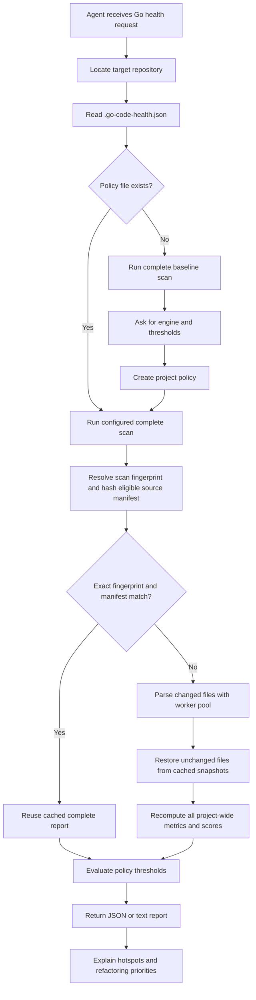

<!-- markdownlint-disable MD013 MD041 -->
[](https://app.codacy.com/gh/sghaida/skills/dashboard?utm_source=gh&utm_medium=referral&utm_content=&utm_campaign=Badge_grade)
[](https://app.codacy.com/gh/sghaida/skills/dashboard?utm_source=gh&utm_medium=referral&utm_content=&utm_campaign=Badge_coverage)
<!-- markdownlint-enable MD013 MD041 -->

# Skills

This repository contains reusable agent skills that extend coding agents with
focused workflows, project guidance, and practical developer tooling. Each
skill is self-contained so it can be installed and used independently in an
agent-enabled development environment.

## `chnq` — Code Health and Quality

`chnq` is a portable Agent Skill with a dependency-free Go static analyzer. It
returns a deterministic, explainable 0–10 structural maintainability score at
repository, package, and file levels.

## Current Capabilities vs. Market Leaders

<!-- markdownlint-disable MD013 MD060 -->

| Feature                              | chnq      | SonarQube          | CodeScene        | GolangCI-Lint      | Codacy       |
|--------------------------------------|-----------|--------------------|------------------|--------------------|--------------|
| **Structural Maintainability Score** | ✅ (0-10) | ✅ (A-F)            | ✅                | ❌                  | ✅            |
| **Go-Specialized**                   | ✅         | ❌ (generic)        | ❌ (generic)     | ✅                  | ❌ (generic) |
| **Architecture Health Metrics**      | ✅ (3)    | ✅ (rules)          | ✅ (architecture) | ✅ (linters)       | ✅ (rules)   |
| **Deterministic**                    | ✅         | ❌ (rules-based)    | ❌ (rules-based) | ✅                  | ❌            |
| **Zero Dependencies**                | ✅         | ❌ (needs Java, DB) | ❌ (SaaS)        | ❌ (needs plugins)  | ❌ (SaaS)    |
| **Security Scanning**                | ❌         | ✅                  | ❌               | ✅                  | ✅            |
| **Test Coverage**                    | ❌         | ✅                  | ✅               | ❌                  | ✅            |
| **Git History Analysis**             | ✅ (opt-in) | ❌                | ✅               | ❌                  | ❌            |
| **CI/CD Integration**                | ✅         | ✅                  | ✅               | ✅                  | ✅            |
| **Caching + Incremental Scans**      | ✅         | ✅                  | ✅               | ❌                  | ✅            |
| **Hotspot Explanations**             | ✅         | ✅                  | ✅               | ❌                  | ✅            |
| **Performance Metrics**              | ✅         | ❌                  | ✅               | ❌                  | ❌            |
| **API/Dashboard**                    | ❌         | ✅                  | ✅               | ❌                  | ✅            |

<!-- markdownlint-enable MD013 MD060 -->

## How the Skill Works

The skill guides an agent through a deterministic, read-only health analysis:



### Analysis Flow

1. The agent identifies the Go repository and reads its optional project policy.
2. The analyzer uses the configured duplication engine and scans source files
   without building or executing the target repository.
3. A local cache reuses a complete report only on an exact semantic
   fingerprint and file-manifest match; otherwise changed files are parsed by
   a bounded worker pool, unchanged files are restored from cached file-local
   snapshots, and every project-wide metric is recomputed over the complete
   model, keeping cached and uncached results semantically identical.
4. The analyzer calculates the four weighted health dimensions plus
   independent cycle, interface-compliance, and duck-typing scores, then
   produces repository, package, and file reports.
5. The policy gate checks the overall score, dimension thresholds, and health
   thresholds before reporting pass or fail.
6. The agent reports measured findings, hotspots, and deterministic improvement
   suggestions.

### Using `chnq` with agentic coding

`chnq` works as a measurable quality gate within an agentic coding workflow.
The analyzer supplies evidence for the agent; it does not replace code review,
tests, security analysis, or the Go compiler.

The recommended workflow is:

1. **Identify the project:** The agent locates the Go module to analyze.
2. **Read the policy:** The agent reads `.go-code-health.json` and uses its
   duplication engine, thresholds, and test-inclusion settings.
3. **Run a baseline:** The agent performs a complete scan before making a
   requested code change.
4. **Review evidence:** The agent checks the overall score, every configured
   dimension, health thresholds, and the highest-priority hotspots.
5. **Make focused changes:** If the user requests implementation, the agent
   addresses the measured findings without changing unrelated behavior.
6. **Verify the result:** The agent runs the same complete scan after the
   change and reports the new measured values and policy status.
7. **Use CI as a guardrail:** The project can run `--fail-under` and compare
   configured dimension and health thresholds in continuous integration.

`chnq` reads source files and Git metadata only when Git churn is explicitly
enabled. It never builds, runs, tests, or modifies the analyzed project. An
agent may edit project files only as a separate, explicitly requested coding
action, followed by a fresh `chnq` scan.

An agent can request a machine-readable report with:

```sh
./chnq/scripts/analyze.sh /path/to/go/repo --format json --no-cache
```

It can then use the measured report to explain why a policy passes or fails,
prioritize hotspots, and verify that a refactoring improved the intended
dimension without claiming that the score proves correctness.

### Quick start

The analyzer requires Go 1.27.3. It has no third-party Go dependencies.

From the repository root, analyze a Go repository as text:

```sh
./chnq/scripts/analyze.sh /path/to/your/go/repo --format text
```

Produce a JSON report:

```sh
./chnq/scripts/analyze.sh /path/to/your/go/repo --format json > health.json
```

Use it as a CI quality gate. This command exits with code 3 when the score is
below the requested threshold:

```sh
./chnq/scripts/analyze.sh /path/to/your/go/repo --fail-under 7
```

Scans use a local `.chnq-health-status` cache (ignored by Git), stored in the
analyzed project root by default. A cached report is reused only on an exact
semantic fingerprint and file-manifest match; after any change, unchanged
files are restored from cached snapshots while all project-wide metrics are
recomputed, so cached and uncached scans report identical results. File
parsing uses 10 workers by default and can be tuned with `--workers 1-256`.
Use `--no-cache` for a complete rescan, `--cache-debug` to see the cache
decision (HIT, INCREMENTAL, MISS, INVALIDATED, REBUILT, or BYPASSED), and
`--cache-info` to inspect stored cache metadata and validity without scanning:

```sh
./chnq/scripts/analyze.sh /path/to/your/go/repo --workers 20
./chnq/scripts/analyze.sh /path/to/your/go/repo --no-cache
./chnq/scripts/analyze.sh /path/to/your/go/repo --cache-debug
./chnq/scripts/analyze.sh /path/to/your/go/repo --cache-info
```

Generate deterministic hotspot explanations without an LLM. The default scope
is files; `package` aggregates low-scoring files by enclosing package:

```sh
./chnq/scripts/analyze.sh /path/to/your/go/repo \
  --explain-hotspots --hotspots-scope package
```

### Benchmark and latency results

The analyzer includes repeatable benchmarks for cold, cached, and incremental
scans in
[`benchmark_test.go`](chnq/cmd/go-code-health/benchmark_test.go). Run them
from the repository root with:

```sh
cd chnq
GOWORK=off go test ./cmd/go-code-health \
  -run '^$' \
  -bench 'Benchmark(Cold|Cached|Incremental)Scan$' \
  -benchmem -count=5
```

The following results are the median of five benchmark runs on an Apple M5
Pro, arm64, using the Go 1.27.3 toolchain and a generated 32-file Go
fixture:

| Benchmark | Median latency | Allocations |
| --- | ---: | ---: |
| Cold scan | 1.47 ms/op | 5,531 allocs/op |
| Cached scan validation and reuse | 0.62 ms/op | 1,280 allocs/op |
| Incremental scan with one changed file | 1.10 ms/op | 2,447 allocs/op |

These are analyzer-core measurements and exclude shell startup, process
startup, and terminal rendering. They are reference results rather than
universal guarantees; hardware, Go toolchain, repository size, worker count,
duplication engine, and filesystem state affect latency. The cached benchmark
includes manifest hashing and fingerprint validation. The incremental
benchmark includes changed-file detection, parsing the changed file, restoring
unchanged files from snapshots, recomputing all project-wide metrics, and
cache writing.

#### Current `chnq` module perspective

For perspective, the current `chnq` module contains 15 Go files, 3,867 source
lines, and 278 functions. An end-to-end run of the installed skill on this
module produced these approximate latencies:

| Scan type | Approximate latency |
| --- | ---: |
| Full scan with `--no-cache` | 360 ms |
| Cached scan (exact fingerprint hit) | 20 ms |
| Incremental scan with one changed file | 70 ms |

These measurements include process startup, manifest hashing, JSON output,
and cache handling with the `jscpd-rs` duplication engine. The full and
incremental scans invoke the external engine over all eligible files, which
dominates their latency; an exact cache hit skips analysis entirely. Larger
repositories see a bigger benefit from avoiding unchanged-file parsing while
every project-wide metric is still recomputed for correctness.

### Project policy and required health gate

For ongoing agentic development, keep a checked-in `.go-code-health.json` at
the root of each project being analyzed. The policy records the acceptable
overall score, optional dimension and health gates, and analyzer policy.
This complete example lists all documented policy keys; its thresholds are
illustrative, not universal recommendations:

```json
{
  "version": 1,
  "duplication_engine": "internal",
  "minimum_score": 7.0,
  "minimum_dimensions": {
    "complexity": 6.0,
    "structure": 7.0,
    "duplication": 8.0,
    "coupling": 6.0,
    "cyclic_dependencies": 8.0,
    "interface_compliance": 7.0,
    "duck_typing": 7.0
  },
  "health_thresholds": {
    "minimum_documentation_percent": 80.0,
    "maximum_ignored_return_values": 0,
    "maximum_panics": 0,
    "maximum_todos": 20,
    "maximum_fixmes": 0,
    "maximum_import_cycles": 0,
    "maximum_dependency_depth": 8,
    "maximum_incoming_dependencies": 20,
    "maximum_git_churn": 2000
  },
  "broad_interface_threshold": 5,
  "goto_check": true,
  "max_function_lines": 60,
  "recursion_check": true,
  "include_tests": false
}
```

#### Configuration keys and who applies them

The Go analyzer directly reads `duplication_engine`,
`broad_interface_threshold`, `goto_check`, `max_function_lines`, and
`recursion_check`. The remaining keys describe the **agent/CI policy**:
the binary does not automatically enforce the JSON minimums or read
`include_tests` as a scan option. Pass `--include-tests` when that policy
value is true, and `--fail-under N` for the overall minimum. An agent or CI
consumer must compare dimension and health thresholds with the JSON report.
Missing or unavailable required measurements must not be treated as passing.

<!-- markdownlint-disable MD013 MD060 -->

| Key | Meaning, default, and calculation |
| --- | --- |
| `version` | Policy schema version, currently `1`; not the scoring-model version. |
| `duplication_engine` | `internal` by default, or `jscpd-rs`. Selects token-duplication measurement; see the duplication calculation below. Missing external binaries produce an error, never a fallback. |
| `minimum_score` | Agent/CI minimum overall score, inclusive, on the 0–10 scale. The example uses `7.0`; there is no automatic binary gate unless `--fail-under 7` is passed. |
| `minimum_dimensions` | Optional independent, inclusive minimums for the seven dimension scores. Each configured score must meet its own target; formulas are below. |
| `health_thresholds` | Optional limits on measured health indicators; these do not directly subtract score points. See the table below. |
| `broad_interface_threshold` | Default `5` (also the legacy fallback for non-positive integers); an interface is broad when its directly declared method count is **greater than** this value. This affects interface compliance, not the four-dimension overall score. |
| `goto_check` | Boolean, default `false`. When true, each `goto` adds **+1** to its function's effective branching complexity and produces a `goto-usage` warning per function. Labeled `break`/`continue` and `fallthrough` do not count. |
| `max_function_lines` | Positive integer, default `80`. Both the length-based structure penalty and the `long-function` warning start **above** this many physical lines. Explicit zero, negative, fractional, or wrong-type values are errors. |
| `recursion_check` | Boolean, default `false`. When true, each function with detected direct recursion adds **+1 total** to effective branching complexity, regardless of its call-site count or justification. Missing justification produces a warning; see the directive below. |
| `include_tests` | Agent/CI scan preference, default `false`; pass `--include-tests` to include `_test.go` files. It changes the analyzed population, not a formula coefficient. |

<!-- markdownlint-enable MD013 MD060 -->

The three new policy keys reject explicit `null` values and invalid types.
Omitting them uses the documented defaults. Raw goto and recursive call counts
remain available even when their checks are disabled.

#### Health thresholds and measured values

All minimums pass at `measured >= minimum`; all maximums pass at
`measured <= maximum`. Omitted thresholds impose no gate.

<!-- markdownlint-disable MD013 MD060 -->

| `health_thresholds` key | Measurement and calculation |
| --- | --- |
| `minimum_documentation_percent` | `100 * documented_exported_symbols / exported_symbols`, rounded to one decimal; zero when there are no exports. Measures GoDoc presence, not quality. |
| `maximum_ignored_return_values` | Count of `_` assignment slots whose same-index right-hand expression is a call, such as `_ = f()`. Not a complete error checker: bare call statements and some multi-result discards are not detected. |
| `maximum_panics` | Number of syntactic calls named `panic`; does not prove that these paths execute. |
| `maximum_todos` | Case-insensitive occurrences of `TODO` in comments. |
| `maximum_fixmes` | Case-insensitive occurrences of `FIXME` in comments. |
| `maximum_import_cycles` | Number of analyzed **files** whose package participates in an internal import cycle, not number of distinct cycles or packages. |
| `maximum_dependency_depth` | Intended limit on internal dependency-chain depth; file/package depth counts the package itself (a leaf has depth 1). See the summary limitation below. |
| `maximum_incoming_dependencies` | Intended limit on package fan-in: distinct internal importing package directories. See the summary limitation below. |
| `maximum_git_churn` | Sum of added and deleted lines attributed to eligible files by `git log --numstat --all`; requires `--include-git-churn`. It covers available history, not a time window. |

<!-- markdownlint-enable MD013 MD060 -->

**Current summary limitation:** dependency depth and incoming dependencies are
reported per file/package but are not aggregated into `summary.health`
(those summary fields currently remain zero). For meaningful gates on these
two metrics, explicitly compare file/package values, for example their
maximum; do not interpret a zero summary value as evidence of no dependencies.
Omit the documentation gate for projects that intentionally have no exports.
Omit the churn gate when churn collection is disabled.

For the example above, a corresponding complete scan is:

```sh
./chnq/scripts/analyze.sh /path/to/your/go/repo --format json \
  --fail-under 7 --include-git-churn
```

#### Recursion justification and limits

Both tail and non-tail direct recursion require a non-empty reason in the
function's doc comment when `recursion_check` is enabled:

```go
// chnq:recursion Recursive traversal is clearer than an explicit stack.
// A runtime depth guard rejects excessive nesting with an error.
func walk(n *Node, depth int) error {
    if n == nil {
        return nil
    }
    if depth >= 128 {
        return fmt.Errorf("maximum tree depth 128 exceeded")
    }
    for _, child := range n.Children {
        if err := walk(child, depth+1); err != nil {
            return err
        }
    }
    return nil
}
```

Here `Node` is the application's tree type and `fmt` is imported. Starting
at depth zero permits non-nil nodes at depths 0–127. Tests should cover the
boundary and error propagation; the analyzer does not validate this guard.

A missing or empty `// chnq:recursion <reason>` produces
`undocumented-recursion`, suggesting iteration or justification. A reason
suppresses that warning, **not** the +1 complexity contribution. A directive
with no detected direct recursion produces a qualified
`stale-recursion-directive` informational finding. The checker validates
reason presence, not its truth; explain why recursion is preferable and how
excessive depth is handled.

Detection uses syntax-based lexical scopes to avoid confusing shadowed
names with self-calls, without type-checking or loading dependencies. It
supports plain and generic functions and calls on the current receiver,
including explicit dereferences (`(*r).f()`) and address-taking (`(&r).f()`).
Type parameters of local generic types and aliases shadow enclosing names
only within their type declarations. Receivers with explicit reassignment
are conservatively excluded. Nested closures, indirect/mutual recursion,
function-value aliases, calls on other receivers, and interface dispatch
are outside coverage. A direct `go f()` launch is not counted as stack
recursion, although recursive calls evaluated in its arguments are counted.
The analyzer does not type-check the project or prove termination, depth
bounds, or stack safety. Go provides no guaranteed tail-call optimization.
There is deliberately no
`max_recursion_depth` analyzer setting or automatic rewrite.

All scoring policy values appear in report `configuration`. Policy changes
invalidate exact cached reports, while unchanged-file raw snapshots remain
reusable and all scores are recalculated.

On the first run, choose the duplication engine:

- `internal` (recommended default): dependency-free Go token detection
- `jscpd-rs`: invokes the installed `jscpd` executable for broader clone
  detection

Install the optional engine with:

```sh
make install-jscpd-rs
```

`make deps` also installs `jscpd-rs` automatically when the repository's
`.go-code-health.json` selects `"duplication_engine": "jscpd-rs"`.

The selected engine is recorded in `.go-code-health.json` and is included in
the analyzer's JSON report. If `jscpd-rs` is selected but `jscpd` is not
installed, the analyzer reports an explicit setup error rather than silently
using a different engine.

On the first run, if the file is absent, the skill performs a full scan,
shows the baseline, asks the user to choose the thresholds, and creates the
file in the project repository. It must run a full scan before every coding
task and again after changes. A task passes only when the scan is complete and
the overall score and every configured dimension meet their thresholds. If an
existing policy fails, code-health remediation takes priority and the agent
must update the code toward the configured values before unrelated work.

See [the project policy reference](chnq/references/project-config.md) for the
complete schema, first-run behavior, and a concrete threshold example.

Run the bundled tests:

```sh
make test
```

The top-level Makefile targets the `chnq` project by default. To scan the
current project with the compiled analyzer:

```sh
make run TARGET=/path/to/your/go/repo FORMAT=text
```

To pass analyzer options through Make:

```sh
make run TARGET=/path/to/your/go/repo ARGS="--fail-under 7"
```

### What it measures

- Go AST branching and nesting complexity
- Optional goto and documented direct-recursion checks affecting complexity
- Oversized functions and files
- Exact repeated 35-token blocks across functions
- Go-module-local package coupling
- Exported API documentation coverage
- Discarded return values and `panic` usage
- TODO/FIXME markers and concurrency operations
- Package fan-in, dependency depth, and import cycles
- Cyclic dependency, interface compliance, and duck-typing scores
- Interface counts, unused interfaces, broad interfaces, and implicit
  implementations
- Optional Git changed-line hotspots (`--include-git-churn`)

Scores range from 0.0 to 10.0. The model is a custom heuristic and is not
equivalent to SonarQube, CodeScene, or an ISO certification.

The three architecture scores are reported independently from the existing
four-dimensional score and can be enforced through `minimum_dimensions`.
`broad_interface_threshold` defaults to 5 methods and can be set per project.
Git churn is opt-in because it depends on repository history and is not a
source-only signal. The analyzer does not measure test correctness, test
coverage, security, type errors, architecture layer violations, or semantic
clones. It never executes code from the repository under analysis.

### How metrics are calculated

The analyzer produces scores from **0.0 to 10.0**, where higher is better.
The model uses these weights:

- **Complexity: 40%**
- **Structure: 25%**
- **Duplication: 20%**
- **Coupling: 15%**

Each file's overall score is the weighted average of its available dimensions.
Package and repository scores are source-line-weighted means of file scores.
Their dimension scores are independently source-line-weighted means of file
dimensions, so intermediate rounding can prevent exact reconstruction of the
overall score from repository dimensions. If coupling
is unavailable because the project has no `go.mod`, the other weights are
renormalized. Scores are rounded to one decimal place in the report.

For policy configuration, see the simple engineer-facing examples in
[the project policy reference](chnq/references/project-config.md).

#### Mathematical equations and a complete final-score example

The equations below define the scoring functions, not Go function names.
Let:

- $R(x)$ mean round to one decimal place.
- $\operatorname{clamp}(x)=\min(10,\max(0,x))$.
- $n$ be the number of functions, $L_i$ function $i$'s physical lines,
  and $N_i$ its maximum nesting depth.
- $F$ be the file's physical lines and $T$ the configured
  `max_function_lines`.

##### Complexity equation

For each function, raw complexity $b_i$ is the sum of `1 + enclosing depth`
for each control-flow statement, plus one per non-default case/communication
clause and one per `&&`/`||`. Let $g_i$ be its goto count and $r_i$ its
detected recursive call-site count. The effective count is:

$$
e_i=b_i+I_g g_i+I_r\mathbf{1}_{r_i>0}
$$

Here $I_g$ and $I_r$ are 1 when their respective checks are enabled,
otherwise 0; $\mathbf{1}_{r_i>0}$ is 1 if recursion is detected, otherwise 0.
The function's complexity score is:

$$
c(e)=
\begin{cases}
10 & 0\le e\le5\\
8 & 5<e\le10\\
6 & 10<e\le15\\
4 & 15<e\le25\\
2 & 25<e\le40\\
0 & e>40
\end{cases}
$$

The file complexity score is:

$$
C=R\left(\operatorname{clamp}\left(
0.8\frac{\sum_{i=1}^{n}\sqrt{\max(1,L_i)}\,c(e_i)}
         {\sum_{i=1}^{n}\sqrt{\max(1,L_i)}}
+0.2\min_i c(e_i)\right)\right)
$$

Thus 80% comes from the weighted average and 20% from the worst score.
A file with no functions has $C=10$.

##### Structure equation

Each function's penalty is:

$$
p_i=\min\left(10,\;
0.08\max(0,L_i-T)+1.25\max(0,N_i-3)\right)
$$

The file-length penalty and final structure score are:

$$
p_F=\min(2.5,\;0.005\max(0,F-400))
$$

$$
S=R\left(\operatorname{clamp}\left(
10-0.6\frac{\sum_{i=1}^{n}p_i}{n}
  -0.4\max_i p_i-p_F\right)\right)
$$

The mean gives every function equal weight. The worst penalty receives
additional emphasis; 60%/40% is a heuristic choice. For a file without
functions, both function-penalty terms are zero.

##### Duplication equation

For the internal engine, let $U$ be tokens covered by duplicate matches
(counted once per token position, including both copies) and $V$ total
function tokens:

$$
q=
\begin{cases}
R(100U/V) & V>0\\
0 & V=0
\end{cases}
\qquad
D=R\left(\operatorname{clamp}(10-q/10)\right)
$$

For `jscpd-rs`, $q$ is the external engine's per-file token percentage,
rounded to one decimal. The same score conversion applies.

##### Complete example: from measurements to final score

Consider one 200-line file with two 80-line functions, `max_function_lines`
set to 60, and both optional complexity checks disabled:

| Input | Function A | Function B |
| --- | ---: | ---: |
| Physical lines $L_i$ | 80 | 80 |
| Maximum nesting $N_i$ | 3 | 3 |
| Raw/effective complexity $e_i$ | 4 | 16 |
| Complexity score $c(e_i)$ | 10 | 4 |
| Structure penalty $p_i$ | 1.6 | 1.6 |

Assume the file has 1,000 function tokens, of which 200 are duplicate
coverage, and its package imports five distinct internal packages.

**1. Complexity:** the equal line counts give equal square-root weights:

$$
C=R\left(0.8\frac{10+4}{2}+0.2(4)\right)=6.4
$$

**2. Structure:** each length penalty is $0.08(80-60)=1.6$;
nesting penalties and the file-length penalty are zero:

$$
S=R\left(10-0.6(1.6)-0.4(1.6)-0\right)=8.4
$$

**3. Duplication:** $q=100(200/1000)=20\%$:

$$
D=R(10-20/10)=8.0
$$

**4. Coupling:** five internal imports exceed the free allowance of four:

$$
K=R\left(\operatorname{clamp}(10-1.25(5-4))\right)=R(8.75)=8.8
$$

**5. Final file score:** use the already-rounded dimension scores:

$$
H=R(0.40C+0.25S+0.20D+0.15K)
$$

$$
H=R(0.40(6.4)+0.25(8.4)+0.20(8.0)+0.15(8.8))
=R(2.56+2.10+1.60+1.32)=R(7.58)=\boxed{7.6}
$$

The cycle, interface-compliance, and duck-typing dimensions are separate
gates and do not enter this weighted score. If coupling is unavailable,
omit it and divide by the sum of available weights:

$$
H=R\left(\frac{0.40C+0.25S+0.20D}{0.85}\right)
$$

**6. Package/repository score:** average the rounded file scores using
source-line weights $w_j=\max(1,F_j)$:

$$
H_{\text{aggregate}}=R\left(\frac{\sum_j w_jH_j}{\sum_j w_j}\right)
$$

For this 200-line file scoring 7.6 and another 100-line file scoring 9.0:

$$
H_{\text{aggregate}}
=R\left(\frac{200(7.6)+100(9.0)}{300}\right)
=R(8.0666\ldots)=\boxed{8.1}
$$

#### Complexity

Complexity estimates how difficult a function's logic is to follow. The
analyzer parses the Go syntax tree and adds points for `if`, `for`, `range`,
`switch`, type switch, and `select` statements, extra nesting, explicit
`case` clauses, and boolean `&&` or `||` operators.

The effective branching complexity includes enabled policy contributions:

```text
effective_complexity = branching_complexity
                    + (goto_check ? goto_count : 0)
                    + (recursion_check AND recursive_calls > 0 ? 1 : 0)
```

Control-flow statements contribute `1 + current nesting depth`; explicit
non-default clauses and `&&`/`||` operators contribute 1 each. The following
score bands use **effective** complexity. For example, raw complexity 5, one goto,
and two recursive call sites becomes 7 with both checks enabled: component
score 8 instead of 10. Justifying recursion does not change this calculation.
Increases within the same bucket do not change the component score.

For effective branching complexity $`e`$, the function score is:

```math
c(e)=
\begin{cases}
10 & 0\le e\le5\\
8 & 5<e\le10\\
6 & 10<e\le15\\
4 & 15<e\le25\\
2 & 25<e\le40\\
0 & e>40
\end{cases}
```

The file score is an 80% weighted mean using `sqrt(max(1, function_lines))`
as each function's weight, plus 20% of the lowest function score. A file
without functions scores 10 for complexity. Raw `branching_complexity` stays
unchanged; nonzero `effective_branching_complexity` records the scored value.

##### Complexity worked example

For example, this fragment contributes four raw complexity points:

```go
for _, item := range items {          // +1: outermost control flow
    if item.Active && item.Ready {    // +2: nested if; +1: &&
        process(item)
    }
}
```

Ordinary function calls add no points unless detected as recursion and that
check is enabled. The count starts at zero, not one.

Suppose a file contains these two functions, with optional checks disabled:

| Function | Physical lines | Raw complexity | Function score | Weight |
| --- | ---: | ---: | ---: | ---: |
| A | 100 | 4 | 10 | `sqrt(100) = 10` |
| B | 25 | 16 | 4 | `sqrt(25) = 5` |

```text
weighted_mean = (10 × 10 + 5 × 4) / (10 + 5) = 8
worst_score = min(10, 4) = 4
file_complexity = 0.8 × 8 + 0.2 × 4 = 7.2
```

Function length affects the averaging weight here, not the raw complexity
count. It is also measured independently by the structure dimension.

#### Structure

Structure estimates whether the code is divided into manageable files and
functions. With `T = max_function_lines` (default 80), the analyzer penalizes
functions longer than `T` lines, nesting deeper than three levels,
and files longer than 400 lines. Function lines include blank and comment
lines from the declaration through its closing brace, excluding its preceding
doc comment. Closures are measured separately.

For physical function lines $`L`$ and maximum nesting depth $`N`$, the
function penalty is:

```math
p(L,N)=\min\left(10,\;
0.08\max(0,L-T)+1.25\max(0,N-3)\right)
```

```text
file_length_penalty = min(2.5, 0.005 × max(0, file_lines − 400))
structure = clamp(10 − 0.6 × mean(function_penalties)
                    − 0.4 × max(function_penalties)
                    − file_length_penalty, 0, 10)
```

Files without functions have no function penalty. A single 80-line function
with no nesting/file-size penalty scores 10 with `T=80`, or 8.4 with `T=60`.
At exactly `T` lines there is no length penalty or `long-function` finding;
at `T+1`, the length penalty is 0.08 and the warning appears. Nesting and
file-size penalties remain independent.

**The configured line count is the exact baseline, not half the limit.**
For example, with `"max_function_lines": 60`:

| Function lines | Length penalty | `long-function` warning |
| ---: | ---: | :---: |
| 40 | 0 | No |
| 60 | 0 | No |
| 61 | 0.08 | Yes |
| 80 | 1.60 | Yes |
| 100 | 3.20 | Yes |

These are only the length contributions, not the complete file penalty.
A function within the line limit can still incur a nesting penalty, and a
file can still incur a file-size penalty.

Model `go-v0.4.0` intentionally replaces the previous half-limit penalty
baseline with the configured limit itself. Scores may improve compared with
`go-v0.3.0`; older cached scores are invalidated automatically.

##### Structure worked example

For a 500-line file with `max_function_lines: 60`:

| Function | Lines | Maximum nesting | Length penalty | Nesting penalty | Function penalty |
| --- | ---: | ---: | ---: | ---: | ---: |
| A | 40 | 2 | 0 | 0 | 0 |
| B | 80 | 3 | `0.08 × 20 = 1.6` | 0 | 1.6 |
| C | 100 | 3 | `0.08 × 40 = 3.2` | 0 | 3.2 |

```text
average_function_penalty = (0 + 1.6 + 3.2) / 3 = 1.6
worst_function_penalty = max(0, 1.6, 3.2) = 3.2
file_length_penalty = min(2.5, 0.005 × (500 − 400)) = 0.5

combined_penalty = 0.6 × 1.6 + 0.4 × 3.2 + 0.5 = 2.74
structure = clamp(10 − 2.74, 0, 10) = 7.26
reported_structure = 7.3
```

The average is an **unweighted arithmetic mean**: every function counts
equally, including zero-penalty functions. Unlike complexity, it does not
use square-root line weights. The worst function is already in the average;
the additional 40% prevents many small functions from hiding one severe
outlier. The 60%/40% split is a custom heuristic, not a NASA requirement.

Nesting can add a penalty even below the length limit. For example, an
80-line function at nesting depth 5 has a penalty of
`min(10, 1.6 + 1.25 × (5 − 3)) = 4.1` with this same limit.

#### Duplication

Duplication estimates how much code is repeated between functions. The
analyzer removes comments and automatically inserted semicolons, keeps exact
identifier and literal spellings, and finds repeated contiguous windows of 35
lexical tokens in different functions. Overlapping matches count only once per
function.

The duplication percentage $`q`$ and score $`D`$ are:

```math
\begin{aligned}
q &= 100\frac{\text{cloned function tokens}}{\text{total function tokens}}\\
D &= \min\left(10,\max\left(0,10-\frac{q}{10}\right)\right)
\end{aligned}
```

This does not detect renamed-variable clones, semantic duplication, or
repetition shorter than 35 tokens.

With `duplication_engine: "jscpd-rs"`, the external engine supplies per-file
duplicate and total token counts; the same score conversion applies. The
35-token exact-window description above applies to the internal engine.

##### Duplication worked example

Suppose two functions in one file each contain 500 tokens, and a matching
100-token block appears in both:

```text
total_function_tokens = 500 + 500 = 1,000
duplicated_tokens = 100 + 100 = 200
duplication_percent = 100 × 200 / 1,000 = 20%
duplication_score = clamp(10 − 20 / 10, 0, 10) = 8.0
```

Both copies contribute to duplicated-token coverage; the analyzer does not
count only the second copy. This measures tokens, not duplicate lines or
number of clone groups. With no function tokens, the internal percentage
is zero and the duplication component scores 10.

| Duplicate-token percentage | Duplication score |
| ---: | ---: |
| 0% | 10 |
| 10% | 9 |
| 20% | 8 |
| 50% | 5 |
| 100% | 0 |

A `duplicate-blocks` warning appears at 10% or higher. That warning does not subtract
additional points. With all four dimensions available, lowering duplication
from score 10 to score 8 lowers the unrounded overall file score by
`0.20 × (10 − 8) = 0.4` points.

##### From file dimensions to package and repository scores

The four available file dimensions are combined using the model weights.
Each dimension is then aggregated using file weight `max(1, file_lines)`.

For example, files of 100 and 300 lines with duplication scores 10 and 8 give
repository duplication `(100 × 10 + 300 × 8) / 400 = 8.5`. This is not a
conversion of the repository-wide token-duplication percentage, which is
reported separately. The same source-line weighting applies to complexity
and structure at package/repository level.

#### Coupling

Coupling estimates how difficult it is to change a package independently. It
counts distinct imports of other packages within the same Go module, excluding
standard-library and third-party imports.

For $`I`$ distinct internal imports, the coupling score is:

```math
K=\min\left(10,\max\left(0,\;10-1.25\max(0,I-4)\right)\right)
```

For example, if a package imports these internal packages:

```text
example.com/store/catalog
example.com/store/payments
example.com/store/users
```

its internal package fan-out is 3. The coupling score is 10 because the first
four internal dependencies do not reduce the score. With five internal
dependencies, the score becomes 8.75; with eight, it becomes 5.0.

The analyzer calculates this separately for each package directory. Every file
in that package receives the package's coupling score, and package/repository
scores are then weighted by source lines. It counts distinct imported package
paths, not the number of import statements or the number of symbols used.

Coupling is unavailable when no `go.mod` can be found in the target or its
parents. The analyzer does not search child directories for nested modules, so
scan a Go module directory directly when the repository contains multiple
modules.

Coupling is a simple dependency-count signal. It does not measure reverse
dependencies, symbol-level usage, interface quality, architecture boundaries,
or whether a dependency is easy to replace.

#### Architecture dimensions

The analyzer also reports three independent architecture dimensions. They are
not included in the weighted overall score, but projects can enforce them with
`minimum_dimensions`:

- **Cyclic dependencies:** Scores package cycle health. It is 10 when no
  package participates in an internal import cycle and decreases for packages
  involved in cycles.
- **Interface compliance:** Scores interface usage and design health. It
  penalizes unused interfaces and interfaces whose method count exceeds
  `broad_interface_threshold`.
- **Duck typing:** Scores AST-based evidence that concrete receiver method sets
  satisfy declared non-empty interfaces. It does not run the Go type checker.

All three architecture dimensions are bounded from 0.0 to 10.0. The
`broad_interface_threshold` setting defaults to 5 methods:

Per-file formulas (then source-line-weighted for package/repository):

```text
cyclic_dependencies = package_in_import_cycle ? 0 : 10
interface_compliance = clamp(10 − 6 × unused_interfaces / interfaces
                                − 4 × broad_interfaces / interfaces, 0, 10)
duck_typing = 10 × matched_interfaces / interfaces
```

When no interfaces are declared, both interface scores are 10. A match means
the AST finds all directly declared interface method **names** on a concrete
type in the same package; signatures, embedded method sets, and Go type-system
assignability are not verified. Empty interfaces count as matched. These are
review signals, not compiler-level conformance checks.

```json
{
  "minimum_dimensions": {
    "cyclic_dependencies": 9.0,
    "interface_compliance": 9.0,
    "duck_typing": 9.0
  },
  "broad_interface_threshold": 5
}
```

##### Cyclic dependencies

A cycle exists when internal packages depend on one another in a loop. For
example, this dependency chain is cyclic:

```text
audio -> filter -> audio
```

The analyzer marks only the packages that participate in the cycle. A package
that is merely imported by a cyclic package is not penalized. A score of 10.0
means no internal package cycle was found; a lower score identifies an
architecture boundary that should be reviewed.

##### Interface compliance

Interface compliance measures whether declared interfaces are useful and
appropriately sized. For example, an interface that is declared but never
used contributes to the unused-interface count:

```go
type AudioLogger interface {
    Log(frame []float32)
}
```

An interface with too many methods is considered broad when it exceeds the
configured threshold:

```go
type AudioProcessor interface {
    Read([]float32) error
    Write([]float32) error
    Reset()
    Configure(sampleRate int)
    Close() error
    Metrics() map[string]float64
}
```

These are design signals rather than compile errors. A project may
intentionally use a broad or currently unused interface, so review the
reported counts before changing code.

##### Duck typing

Go interfaces are satisfied implicitly. In this example, `FileSource` has the
method required by `AudioSource`, so it is evidence of duck typing:

```go
type AudioSource interface {
    Read() ([]float32, error)
}

type FileSource struct{}

func (FileSource) Read() ([]float32, error) {
    return nil, nil
}
```

The analyzer looks for declared non-empty interfaces and matching concrete
receiver method sets in the same package. It reports method-set evidence; it
does not build the project, resolve every cross-package type relationship, or
replace `go vet` and the Go compiler.

For example, a report may contain:

```json
{
  "dimensions": {
    "cyclic_dependencies": 10.0,
    "interface_compliance": 9.8,
    "duck_typing": 9.4
  },
  "health": {
    "import_cycles": 0,
    "interface_count": 11,
    "unused_interfaces": 1,
    "broad_interfaces": 1,
    "implicit_implementations": 2
  }
}
```

#### Additional health metrics

The JSON report includes a `health` object at repository and file level:

- `exported_symbols` and `documentation_percent` measure public API
  documentation coverage.
- `ignored_return_values` and `panics` identify reliability review points.
- `todos`, `fixmes`, `goroutines`, and `channel_operations` provide
  maintainability and concurrency indicators.
- `incoming_dependencies`, `dependency_depth`, and `import_cycles` describe
  package graph structure.
- `git_churn` is populated only with `--include-git-churn`; `git_hotspots`
  contains the five files with the most changed lines.

These are deliberately exposed as raw measurements and findings rather than
new score dimensions, so existing score thresholds remain comparable across
scans. Findings include undocumented exports, discarded return values, panic
usage, import cycles, and high Git churn.

#### Aggregation

File scores are combined into package and repository scores using source lines
as weights. The analyzer also reports individual dimension averages, package
scores, file scores, and up to five lowest-scoring files below 8.0 as
hotspots.

#### God-object review

The skill also performs a qualitative god-object review for hotspots and
packages with weak structure scores. It inspects Go structs and their methods
for one type that owns several unrelated responsibilities, such as I/O,
parsing, business rules, and reporting.

This is a design observation, not a numeric analyzer metric. The skill reports
the type, file, line, responsibilities, and evidence. A large type or a type
with many methods is not automatically a god object; the responsibilities must
be meaningfully unrelated.

#### Mixed-responsibility review

The skill also reviews hotspot files and packages for unrelated concerns
grouped together. Examples include a package that performs file or network
I/O, parses data, applies business rules, persists results, formats output,
and owns test assertions.

The skill reports:

- The file or package with mixed responsibilities
- Each responsibility found
- The code evidence supporting the observation
- A possible focused split, such as moving parsing, persistence, or reporting
  into separate components

This is also a qualitative design observation. A file or package is not a
problem merely because it contains several functions; the responsibilities
must be meaningfully unrelated.

### Installation

#### Install as an agent skill for users

For end users on macOS or Linux, download the release installer:

```sh
curl --fail --location \
  https://github.com/sghaida/skills/releases/latest/download/install.sh \
  --output install.sh
chmod +x install.sh
./install.sh
```

The installer asks whether to install for Claude, Codex, or Copilot, and
whether to install for the current project or the user environment. It
downloads the matching prebuilt analyzer binary automatically. Go is not
required.

Release installations use the bundled native binary and do not require Go.

You can also download a specific tagged installer:

```sh
curl --fail --location \
  https://github.com/sghaida/skills/releases/download/v1.0.0/install.sh \
  --output install.sh
chmod +x install.sh
./install.sh
```

Non-interactive examples:

```sh
./install.sh --target claude --scope user
./install.sh --target codex --scope project
./install.sh --target copilot --scope user
```

Releases are published only when a `v*` Git tag is pushed and include
platform-specific archives and SHA-256 checksums. The standalone
`install.sh` file is included in every release.

#### Install as an agent skill for developers

For repository development only, the source tree can still be installed
manually into an agent's skills directory. Common options include:

- Codex (project): `<repo>/.agents/skills/go-code-health/`
- Codex (user): `~/.agents/skills/go-code-health/`
- Claude Code (project): `<repo>/.claude/skills/go-code-health/`
- Claude Code (user): `~/.claude/skills/go-code-health/`

The Makefile can install it for Claude Code:

```sh
make install-claude
```

For Codex, install it in the user skills directory:

```sh
make install-codex
```

For GitHub Copilot Chat, install it as a repository skill under
`.github/skills`:

```sh
make install-github
```

Then use Copilot Chat in Agent mode and ask:

```text
Use the go-code-health skill to analyze this repository.
```

For a single project, override the destination:

```sh
make install-claude CLAUDE_SKILLS_DIR=/path/to/project/.claude/skills
make install-codex CODEX_SKILLS_DIR=/path/to/project/.agents/skills
make install-github GITHUB_SKILLS_DIR=/path/to/project/.github/skills
```

Then ask the agent:

> Use go-code-health to score this repository and explain the worst three files.

The skill instructions tell the agent to run the bundled command and use its
actual JSON report instead of guessing a score.

### Repository layout

```text
skills/
├── Makefile
├── README.md
└── chnq/
    ├── SKILL.md
    ├── go.mod
    ├── cmd/go-code-health/
    ├── scripts/
    ├── references/
    └── examples/
```

`chnq` is an initial model and is not yet calibrated against independent human
reviews of real Go code. Before using the score for PR blocking across teams,
validate thresholds against varied Go services and manually rated examples.

### Developer dependencies

The development workflow requires Go 1.27.3 and the latest
`golangci-lint` v2 CLI. The Makefile installs `golangci-lint` automatically
when running the lint target:

```sh
make install-golangci-lint
make precheck
```

`make precheck` runs formatting, module tidy, tests, `go vet`, and
`golangci-lint` using the repository configuration in
[`.golangci.yml](./.golangci.yml). Install the repository-managed pre-commit
hook to run the same checks before every commit:

```sh
make install-hooks
```

GitHub Actions runs the same precheck and publishes Go coverage to Codacy.
Add a repository secret named `CODACY_PROJECT_TOKEN` before enabling the
Codacy upload step.

### Contributing

Contributions should be focused, preserve the analyzer's deterministic
read-only behavior, and include tests for behavior changes. Before submitting
a change:

```sh
make install-hooks
make precheck
make build
```

Keep generated build output, local caches, editor settings, and profiling
artifacts out of commits. Update the relevant skill documentation when
changing its behavior, and describe the validation performed in the pull
request.
